  

  
  

<h2>👋 About me</h2>

<ul>
  <li>🛒 Building a multi-vendor marketplace: customer, seller, courier and admin apps on one backend</li>
  <li>📱 Shipping cross-platform mobile apps with <b>Flutter</b> and <b>React Native / Expo</b></li>
  <li>🌐 Web frontends with <b>Next.js</b> + <b>Tailwind</b>, APIs with <b>Node / Express</b> + <b>Prisma</b></li>
  <li>🤖 Into AI coding tools and agent skills</li>
</ul>

<h2>🧰 Tech stack</h2>

  

<h2>📊 Stats</h2>

  
  

  

<h2>🐍 Contributions</h2>

  <picture>
    <source media="(prefers-color-scheme: dark)" srcset="https://raw.githubusercontent.com/Hamza-Masuadi/Hamza-Masuadi/output/github-snake-dark.svg" />
    <source media="(prefers-color-scheme: light)" srcset="https://raw.githubusercontent.com/Hamza-Masuadi/Hamza-Masuadi/output/github-snake.svg" />
    
  </picture>

  

